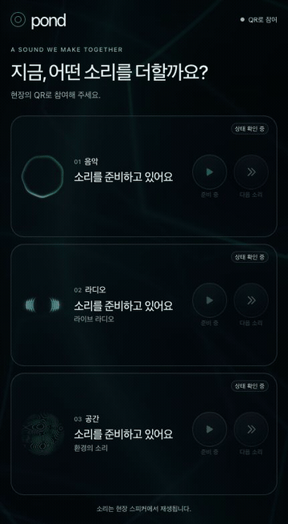
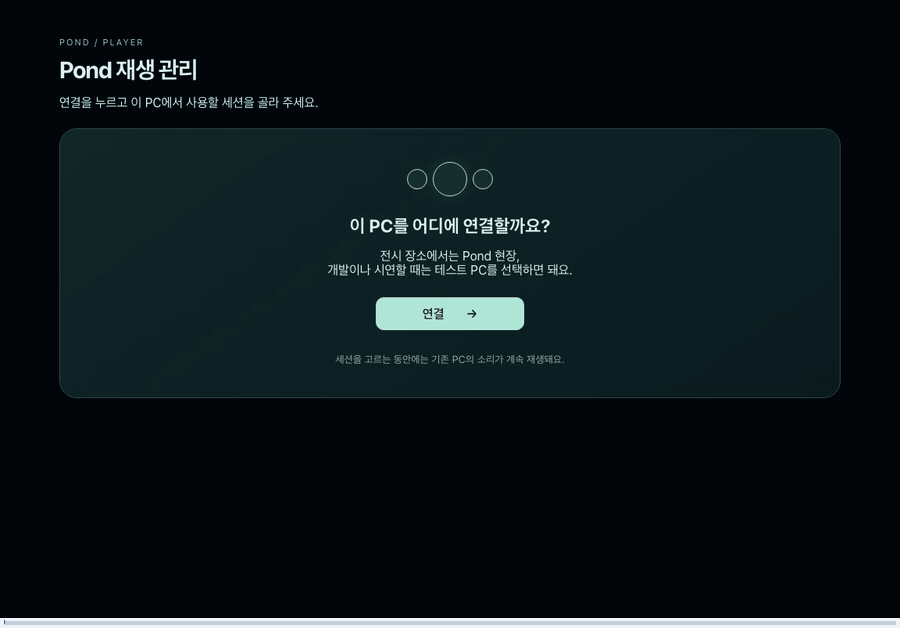
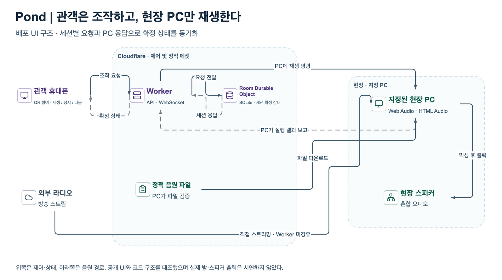
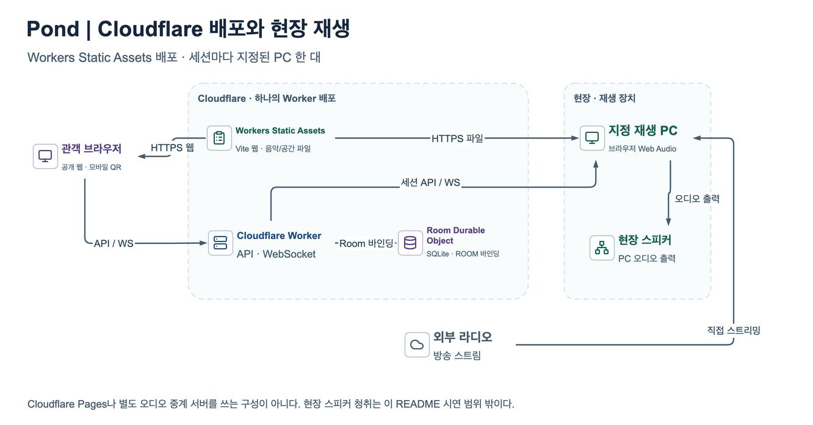
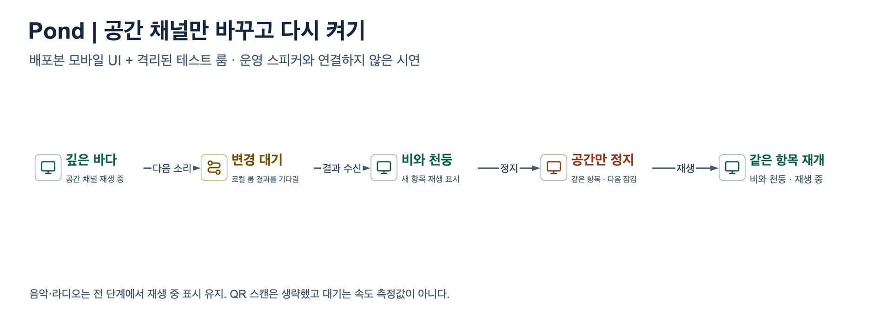

# Pond

> 이 저장소에는 관객용 UI의 시연과 설계 문서를 담았습니다.

전시장 관객이 휴대폰으로 **공동 스피커의 음악·라디오·공간음**을 바꾸는 사운드 인터랙션. 관객은 QR로 참여하고, 실제 음원 재생과 믹싱은 현장 PC 한 대에서 맡는다.

| | |
| --- | --- |
| 용도 | QR로 참여하는 전시 사운드 인터랙션 |
| 담당 범위 | 모바일 관객 UI, 운영자 세션·재생 화면, 실시간 제어·상태 동기화, 브라우저 오디오와 Cloudflare 배포 |
| 구현 환경 | React · TypeScript · Web Audio · WebSocket · Cloudflare Workers/Durable Objects |
| 프로젝트 링크 | [Pond 열기](https://pond.castlekong1019.workers.dev/) |

## 해결한 문제

휴대폰마다 소리를 내면 한 공간에서 함께 듣는 경험이 사라진다. 반대로 한 스피커를 여러 사람이 제어하면 조작을 눌렀다고 해서 실제 소리가 바뀌었다는 뜻은 아니다. 재생은 지정된 PC 한 대에 두고, 그 PC가 보고한 결과를 관객과 운영자가 같은 화면 상태로 보도록 했다.

## 시연 · 음악과 라디오를 그대로 두고 공간음만 바꾸기

참여 화면에서 공간음만 **깊은 바다 → 비와 천둥**으로 바꾼다. 공간음을 멈췄다가 다시 켜도 음악과 라디오 카드의 재생 상태는 그대로다.



[시연 단계와 확인 조건](docs/portfolio-readme/docs/demo-scenario.md) · [공개 배포 UI 첫 화면](docs/portfolio-readme/assets/readme/pond-public-root.png) · [참여 후 모바일 정지 이미지](docs/portfolio-readme/assets/readme/pond-audience-mobile.png)

## 운영자 시연 · 테스트 PC 연결과 전체 정지

테스트 PC에 연결해 준비된 채널을 시작하고, 재생 상태를 확인한 뒤 ‘전체 정지’를 누른다.



[역할별 사용 흐름](docs/portfolio-readme/docs/role-flows.md)

## 기능별 사용 흐름

| 사용자 | 할 수 있는 일 | 화면과 확인 지점 |
| --- | --- | --- |
| 관객 | 현장 QR로 참여해 음악·라디오·공간을 채널별로 정지하거나 다음 소리로 바꾼다. | [참여 화면](docs/portfolio-readme/assets/readme/pond-audience.png). 준비된 다음 항목이 없거나 PC가 준비되지 않으면 다음 버튼은 비활성이다. |
| 관객 | 멈춘 채널을 같은 항목으로 재개한다. | [공간만 정지된 화면](docs/portfolio-readme/assets/readme/pond-audience-stopped.png). 음악·공간 파일은 처음부터, 라디오는 같은 방송국의 현재 방송으로 돌아간다. |
| 운영자 | 관리자 연결 후 Pond 현장 또는 테스트 PC 세션을 열고 준비된 채널을 시작한다. | [세션 선택 화면](docs/portfolio-readme/assets/readme/pond-admin-session.png). 세션마다 재생 PC는 한 대. 참여 중단과 스피커 재생 중지는 별개다. |
| 관객과 운영자 | 누른 요청이 처리됐는지 확인한다. | 관객 입력은 우선 대기로 표시한다. 지정 재생 PC의 결과를 받아야 카드가 확정 상태로 바뀐다. |

## 설계 결정

### 음원 요청 수는 줄이고, 중단돼도 받은 부분은 살렸다

초기에는 브라우저가 음원을 받으면서 재생했지만 재생 도중 끊김이 있었다. 완전히 받은 파일만 재생하도록 바꾼 뒤에는, 처음 쓰는 PC에서 첫 두 음원만으로도 64KiB 조각 요청이 37번 필요했다. 이어받기는 가능했지만 작은 요청마다 대기 시간이 붙었다. 전시 시작에 필요한 첫 음악과 첫 공간음은 병렬로 받고, 나머지 후보는 그 뒤에 준비하도록 우선순위를 나눴다.

정상 경로에서는 MP3당 요청 한 번으로 받는다. 응답을 읽으면서 64KiB 단위로 해시를 확인해 조각을 저장하고, 다운로드가 중단되면 확인된 조각은 남겨 누락분만 요청한다. 완성된 파일의 크기와 SHA-256까지 맞아야 Web Audio 버퍼로 디코딩한다. 첫 두 파일의 정상 경로가 조각 요청 37회에서 MP3 요청 2회로 바뀌었고(공통 manifest 제외), 반복 재생은 PC에 준비된 버퍼를 사용한다. 라디오는 파일 캐시와 섞지 않고 재생 PC에서 방송국 스트림에 직접 연결한다.

### 버튼을 누른 상태와 재생 결과를 분리했다

여러 관객이 동시에 같은 채널을 조작할 수 있고, 현장 PC에 늦게 도착하는 요청도 있다. 버튼을 누른 즉시 곡명을 바꾸면 아직 기존 음원이 나오는 동안 관객 화면만 다음 곡을 보여주게 된다. Room은 요청을 접수하면 해당 채널만 ‘변경 중’으로 잠그고, 지정된 PC에서 처리 결과가 돌아온 뒤 확정 상태를 방송한다.

PC 결과는 요청 ID, 채널 순번, 플레이어 세대가 현재 대기 중인 명령과 모두 일치할 때만 반영한다. 제어 연결이 끊기면 새 PC에 자동으로 넘기지 않는다. 단절된 기존 PC가 계속 소리를 낼 수 있기 때문이다. 같은 PC가 돌아와 실제 재생 상태를 보고해야 관객 제어가 다시 열린다. 참여를 닫거나 전체 정지한 뒤에 늦게 도착한 응답도 그 결정을 되돌리지 않는다.

### 현장과 테스트를 나눠 같은 운영 화면을 쓸 수 있게 했다

기존 룸 하나를 테스트에도 함께 쓰면 현장과 시험 운영이 참여 코드, 채널 상태, 재생 PC 지정 정보를 공유한다. 운영자가 같은 사이트에서 리허설할 수 있도록 관리자 연결 화면에 ‘Pond 현장’과 ‘테스트 PC’를 분리했다. 연결 화면에서 세션을 선택하기 전에는 인증·상태만 조회하고, 선택한 세션에서만 관리자 연결과 재생 PC 지정이 이뤄진다.

현장 세션은 이미 운영하던 Room의 저장 상태를 그대로 쓰고, 테스트 세션에 별도 Durable Object를 할당했다. 세션마다 관객 QR이 열어 주는 Room, 현재 채널, 재생 PC가 따로 움직인다. UI를 복제해 두 운영 화면을 유지할 필요 없이, 세션 경계 안에서 같은 제어 동작을 사용할 수 있다.

[설계 변경과 구현 근거](docs/portfolio-readme/docs/design-evidence.md)

## 시스템과 배포 구조



Cloudflare가 정적 웹과 파일 음원을 제공하고, Worker가 API와 WebSocket을 세션별 SQLite Durable Object에 연결한다. Room은 재생 명령과 상태를 관리하지만 실제 믹싱과 스피커 출력은 현장 PC 브라우저의 Web Audio가 맡는다.

[편집용 draw.io](docs/portfolio-readme/assets/readme/architecture.drawio)

## 배포 인프라



정적 웹과 파일 음원은 Workers Static Assets로 제공한다. 세션 연결은 Worker가 처리하고, 각 Room의 제어 상태는 Durable Object의 SQLite에 저장한다.

[배포 인프라 draw.io 원본](docs/portfolio-readme/assets/readme/infrastructure.drawio)

## 공간 채널 조작 흐름



[시연 흐름 draw.io 원본](docs/portfolio-readme/assets/readme/workflow.drawio)

## 로컬 실행

```sh
nvm use
npm ci
npm run setup:admin
npm run dev
```

`setup:admin`으로 로컬 테스트 비밀번호를 설정한다. 터미널에 표시된 주소의 `/admin`에서 세션을 선택하고 재생 PC 브라우저에서 직접 전시 시작을 누른다. `npm run check`는 린트·타입·프런트/Worker 빌드 검사다.

운영과 배포 구성은 저장소의 `docs/operations/runbook.md`, `docs/architecture/system.md`에 정리했다.
